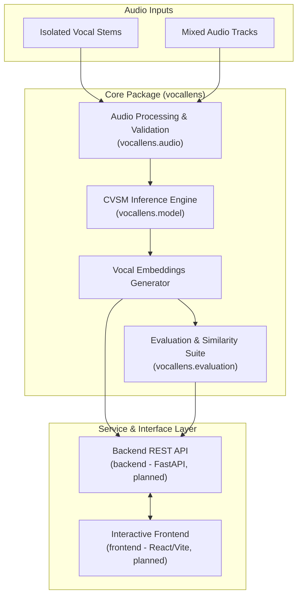

# VocalLens

**An interactive vocal similarity analysis platform built around the original CVSM (*Contrastive Vocal Similarity Modeling*) research implementation.**

---

## 1. Project Overview

**VocalLens** is a research and engineering platform designed to analyze, visualize, and compare vocal similarity and singing characteristics across audio recordings. The platform is structured around the foundational research introduced in *CVSM: Contrastive Vocal Similarity Modeling* (Garoufis et al.), a self-supervised contrastive learning framework engineered to evaluate vocal similarity across both isolated vocal tracks and complex polyphonic musical mixtures.

The primary mission of VocalLens is to bridge research-grade contrastive vocal embeddings with accessible, modular engineering. By providing structured audio preprocessing, standardized evaluation metrics, an API service layer, and an interactive interface, VocalLens aims to facilitate empirical investigation and qualitative auditioning of vocal similarity representations.

---

## 2. Problem Statement

Quantifying vocal similarity algorithmically presents substantial acoustic and perceptual challenges:

* **Timbral Complexity**: Singing voice quality is governed by a multidimensional combination of vocal tract geometry, phonation mechanisms, vibrato, formant distribution, and expressive articulation.
* **Mixture Interference**: In realistic musical scenarios, vocals are rarely heard in isolation. Instrumental accompaniment, percussion, spatial reverberation, and studio production techniques frequently obscure or distort subtle vocal timbral cues.
* **Semantic Entanglement**: Acoustic models often inadvertently conflate intrinsic vocal characteristics with extrinsic factors such as musical genre, language, key, melody, tempo, or lyrical content.
* **Tooling Accessibility**: Research prototypes in vocal similarity modeling typically exist as standalone scripts or offline command-line routines, leaving a gap for tools that support interactive comparison, side-by-side listening, and visual exploration of latent spaces.

---

## 3. Project Objectives

* **Modularize Research Code**: Package the CVSM research methodology into a clean, reusable Python library (`vocallens`) with clear abstractions for audio handling, model inference, and metric evaluation.
* **Standardize Ingestion & Preprocessing**: Develop strict validation and preprocessing pipelines to ensure acoustic inputs conform to model assumptions across varying formats and sample rates.
* **Systematize Evaluation**: Establish a reproducible benchmarking suite supporting multiple distance metrics, ranked retrieval protocols, and comparative evaluations.
* **Deliver an Interactive Platform**: Provide a decoupled backend API and web frontend for uploading recordings, computing embeddings, and visually analyzing vocal similarity in an interactive environment.
* **Investigate Open Research Questions**: Empirically evaluate the boundaries and potential edge cases of the CVSM baseline under controlled experimental conditions.

---

## 4. Original CVSM Baseline

The foundational modeling approach within VocalLens derives directly from the research paper:

> **Paper**: *CVSM: Contrastive Vocal Similarity Modeling*
> **Authors**: Christos Garoufis, Athanasia Zlatintsi, and Petros Maragos
> **Official Repository**: [github.com/cgaroufis/CVSM](https://github.com/cgaroufis/CVSM)

### Core Principles of CVSM:
* **Contrastive Self-Supervised Learning**: Designed to learn robust vocal representations by contrasting positive and negative audio pairs in latent space.
* **Cross-Context Agreement**: Formulated to maximize latent agreement between isolated vocal excerpts and full musical mixtures containing those same vocal performances.
* **Contrastive Pairing Protocols**:
  * *Label-informed protocol*: Leverages artist identity to supervise contrastive pair selection across distinct tracks.
  * *Label-agnostic scheme*: Synthesizes artificial mixtures by pairing isolated vocal stems with randomly sampled instrumental accompaniments, removing the dependency on artist annotations.
* **Acoustic Representation**: Processes time-frequency representations through a deep neural network backbone to produce fixed-dimensional vocal embeddings.
* **Nature of Learned Representations**: CVSM embeddings represent learned vocal similarity features optimized through contrastive objectives rather than pure, isolated physical measurements of vocal timbre. Consequently, representations reflect relative similarity patterns within the model's training distribution and may encompass correlated vocal attributes alongside timbral properties.

> [!NOTE]
> CVSM serves as the baseline model for VocalLens. VocalLens encapsulates this architecture and builds surrounding platform infrastructure; it does not claim to independently reproduce or validate the original paper's published experimental figures at this stage.

---

## 5. Limitations Under Investigation

To rigorously understand the behavior of CVSM in real-world applications, VocalLens frames key performance boundaries as **potential issues to investigate** through systematic experimentation:

### 1. Similarity Discrimination
* Investigating how reliably the latent space distinguishes subtle timbral nuances between similar singers versus coarse acoustic features (e.g., pitch register, dynamic range, or vocal distortion).
* Evaluating whether embeddings over-index on pitch contours or genre-specific production characteristics rather than distinct vocal identity.

### 2. Audio Segment Duration
* Investigating the sensitivity of embedding stability across short temporal excerpts (e.g., $< 3$ seconds) versus longer phrases.
* Examining the behavior of temporal pooling strategies when handling inputs of variable duration.

### 3. Background Noise and Recording Quality
* Investigating embedding degradation under varying signal-to-noise ratios (SNR), microphone characteristics, amateur recording environments, and lossy audio compression formats.
* Assessing resilience to acoustic reverberation and varying levels of accompaniment bleed.

### 4. Domain Generalization
* Investigating representation quality when applied to non-Western musical traditions, diverse linguistic phonetics, and extended vocal techniques (e.g., operatic projection, growling, falsetto, throat singing).
* Assessing domain shifts when moving from commercial studio masters to unproduced home recordings.

---

## 6. Proposed Improvements

VocalLens proposes several architectural and operational enhancements built around the core baseline.

> [!IMPORTANT]
> The items below represent planned engineering and research additions in active development. They are exploratory platform enhancements and must not be interpreted as having demonstrated or established improvements in model accuracy or benchmark performance.

| Component | Original CVSM Baseline | Proposed VocalLens Enhancement |
| :--- | :--- | :--- |
| **Input Pipeline** | Research-oriented file loading scripts | Standardized validation, format verification, and experimental preprocessing options (e.g., optional LUFS loudness normalization) |
| **Inference Interface** | Standalone experiment scripts | Standardized, object-oriented inference and embedding generation pipeline |
| **Similarity Metrics** | Fixed distance evaluations | Multi-metric framework (cosine distance, Euclidean, ranked retrieval, and top-$k$ nearest neighbors) |
| **Exploration & UI** | Offline evaluation tables | Interactive web interface with side-by-side audio playback and projection visualizations |
| **System Architecture** | Monolithic local execution | Decoupled client-server architecture with a RESTful API backend |

---

## 7. Technology Stack

To preserve technical integrity, the original CVSM research dependencies are clearly differentiated from the planned VocalLens application dependencies:

### Original CVSM Baseline Dependencies
* **Deep Learning Framework**: TensorFlow (as implemented in the original research codebase)
* **Numerical Processing**: NumPy, SciPy

### VocalLens Core & Audio Pipeline
* **Audio Processing**: Librosa and SoundFile (subject to verified requirements and compatibility with CVSM feature representations)
* **Evaluation & Metrics**: Scikit-learn
* **Testing & Quality Assurance**: Pytest

### Planned Application & Interface Stack
* **Backend API**: FastAPI, Uvicorn, Pydantic *(planned)*
* **Frontend Client**: React and Vite, TypeScript *(planned)*
* **Analysis & Visualization**: Matplotlib, Seaborn, JupyterLab *(planned)*

---

## 8. Project Architecture

The high-level architecture illustrates the end-to-end data flow from audio ingestion to interactive analysis:



### Directory Structure Overview

```text
VocalLens/
├── research/              # Literature notes, architecture documentation, and experiment plans
├── src/vocallens/         # Core Python package
│   ├── audio/             # Preprocessing, validation, and feature routines
│   ├── model/             # CVSM inference wrapper and embedding extraction
│   ├── evaluation/        # Similarity metrics and benchmarking routines
│   └── utils/             # Configuration and shared utilities
├── backend/               # FastAPI service endpoints and requirements (planned)
├── frontend/              # Interactive user interface application (planned)
├── experiments/           # Jupyter notebooks and evaluation results
├── tests/                 # Unit and integration test suite
└── docs/                  # System architecture specifications and visual assets
```

---

## 9. Development Roadmap

* **Phase 1: Project Setup & Baseline Scaffolding** *(Active)*
  * [x] Repository initialization and modular directory structure setup
  * [ ] Research literature documentation and baseline architecture review *(In progress)*
* [ ] **Phase 2: Audio Ingestion & Preprocessing**
  * Implement audio validation, format conversion, feature extraction, and experimental preprocessing options (including optional LUFS normalization)
* [ ] **Phase 3: Model Wrapper & Embedding Generation**
  * Integrate original CVSM model architectures, weight-loading routines, and forward inference passes
* [ ] **Phase 4: Evaluation Suite & Similarity Metrics**
  * Develop cosine and distance metric computations, ranking evaluation protocols, and automated test coverage
* [ ] **Phase 5: Backend API Development**
  * Expose REST endpoints for audio upload, embedding computation, and similarity search
* [ ] **Phase 6: Interactive User Interface**
  * Build the frontend client for audio comparison, waveform visualization, and latent embedding inspection
* [ ] **Phase 7: Empirical Investigation & Benchmarking**
  * Conduct structured experiments on segment duration, background noise, and domain transfer

---

## 10. Current Project Status

The VocalLens project is currently in **Phase 1 (Scaffolding & Research Planning)**.

* The project directory tree, modular package structure, and research markdown stubs have been established.
* Initial module stubs are in place across `src/vocallens/`, `backend/`, and `tests/`.
* Research documentation, original code review, and environment verification are in progress.
* Deep learning model integration, package dependency installation, and dataset ingestion are scheduled for subsequent phases.

---

## 11. References

* **Research Paper**: Garoufis, C., Zlatintsi, A., & Maragos, P. (2025). *CVSM: Contrastive Vocal Similarity Modeling*. arXiv preprint arXiv:2510.03025.
* **Official Codebase**: [cgaroufis/CVSM (GitHub)](https://github.com/cgaroufis/CVSM)
